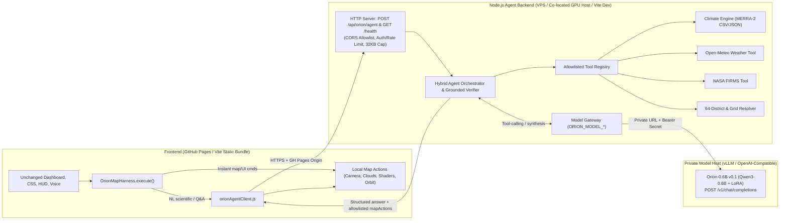

# Orion Space — Agent Architecture & Phase 1 Design

- **Branch:** `feat/orion-agent-architecture`
- **Base revision audited:** `main` (`ed39f25`)
- **Model target:** `Orion-0.6B v0.1` (`Qwen/Qwen3-0.6B` + LoRA SFT)
- **Status:** Phase 1 Architecture Document (ready for review before Phase 2 implementation)

---

## 1. Non-Negotiable UI & Visual Boundary

**Rule:** Do **not** alter the existing dashboard appearance, CSS, HUD, templates, or visual components.

- **Frozen (DO NOT MODIFY):**
  - `index.html`, `style.css`
  - `src/ui/` (`templates/*.html`, `styles/*.css`, `applicationShell.js`, `layerPanel.js`, etc.)
  - `src/components/`, `src/app/`, `src/standalone/`
  - `src/voice/` (keeps the existing OpenAI Realtime WebRTC voice action system separate)
  - The DOM markup, CSS classes, layout, and visual styling inside `OrionMapHarness.mount()` and `OrionMapHarness.showEvidenceCard()` (`src/agent/OrionMapHarness.js`)
- **Permitted Frontend Surface (Minimal Bridge Only):**
  - `OrionMapHarness.execute(rawCommand)` inside `src/agent/OrionMapHarness.js`
  - A small client helper module (proposed: `src/agent/orionAgentClient.js`) that calls the backend `POST /api/orion/agent`
  - A **public** build-time/runtime backend base URL configuration (e.g. `VITE_ORION_AGENT_BASE_URL` or `window.__ORION_AGENT_CONFIG__`); **no secrets may ever be placed in frontend config or `VITE_*` variables**.

---

## 2. Existing Codebase Audit

### 2.1 Assets to Reuse Directly

| Existing File / Module | What It Already Provides | Phase 2–4 Role |
| --- | --- | --- |
| `src/agent/bangladeshDistricts.js` (`BANGLADESH_DISTRICTS`, `findDistrictSector`) | Pure ES module (no Cesium or DOM imports) with all 64 Bangladesh districts, coordinates, altitudes, and Bangla/Banglish aliases | **Reuse in both browser and Node.js backend** as the canonical district/sector resolver |
| `src/agent/OrionMapHarness.js` (`OrionMapHarness`, `SECTORS`) | Cesium camera maneuvers (`flyToSector`, `flyToCoords`, `startOrbit`, `stopOrbit`), `triggerClouds`, `triggerShader`, `showEvidenceCard`, Web Speech STT/TTS, chat transcript DOM | **Keep visual UI & Cesium actions intact**; bridge only `execute()` to backend for natural-language & scientific queries |
| `src/layers/weather/RealEarthCloudStream.js` | Client-side NASA GIBS WMTS live cloud layers (MODIS Terra/Aqua, VIIRS SNPP/NOAA-20) | Keep client-side; triggered via existing `clouds` map action |
| `analysis/trend_analysis.py`, `analysis/results/t2m_trends_by_cell_month.csv`, `analysis/results/summary.md` | Reproducible 2001–2025 MERRA-2 T2M trend dataset: 104 cells (34 inside Bangladesh), 442 cell×month series, Mann-Kendall, Theil-Sen slope, Benjamini-Hochberg FDR (`q = 0.05`), TFPW autocorrelation check | **Primary scientific ground-truth source** for the backend climate tool engine |
| `public/data/climate/` | Bundled raw JSON (`bangladesh_t2m_regional_raw.json`), boundary GeoJSON, and spatial/seasonal CSVs | Keep bundled for static/offline fallback and local climate map visualization |
| `server/providers/common/` (`http.js`, `request.js`, `rate-limit.js`, `query.js`, `geo.js`) | Capped request/response readers (`readRequestBody`, `readRequestBodyCapped`, `readCappedResponseText`), request coalescing, per-IP rate limiting (`makeRateLimiter`, `makeOptInRateLimiter`, `clientKey`) | **Reuse directly** in backend middleware and model gateway |
| `server/providers/regional/weather.js` (`fetchRegionalWeather`), `place.js`, `briefing.js` | Server-side Open-Meteo current weather fetch + normalization (`src/data/regionalModel.js`) and place lookup | **Reuse** inside the backend `get_live_weather` tool instead of browser-direct Open-Meteo calls |
| `server/providers/firms.js` | Memory + disk-cached NASA FIRMS VIIRS/MODIS active fire proxy (`/api/firms`) | **Reuse / wrap** in backend `get_active_fires` tool (with explicit `unavailable` state when `FIRMS_MAP_KEY` is absent) |
| `server/providers/openai/hud-summary.js` & `rate-limit.js` | Reference implementation for POST JSON handling, 64 KB body cap, opt-in per-IP rate limits, and sanitized upstream errors | Follow the exact same security & error-sanitization pattern |

### 2.2 Experimental / Unwired Code (Do NOT Build On)

- `src/osint/` (including `src/osint/ai_analyst/OrionAIIntelligenceConsole.js`) is documented in `README.md` as experimental and **not wired into the running app**, with several modules generating simulated numbers. Do **not** build the new agent runtime or training data on `src/osint/`.

### 2.3 Critical Gaps & Bugs Found During Audit

1. **No Orion Agent Backend or Model Gateway Yet:**
   - `server/providers/local.js` currently registers only Vite proxy plugins. There is no `POST /api/orion/agent`, `GET /health`, `ORION_MODEL_*` gateway, or standalone Node HTTP entrypoint for non-Vite deployments (GitHub Pages frontend + VPS/GPU backend).
2. **Hardcoded / Conflicting Numbers in `OrionMapHarness.js`:**
   - `handleSeasonalDissociationQuery()` quotes `Annual Mean: +0.03°C/dec | Oct: +0.45°C/dec` and `Oct p=0.007`, whereas `analysis/results/summary.md` reports Annual median `+0.021°C/decade` (`0 of 34` at `p<0.05`) and October median `+0.389°C/decade` (`29 of 34` at `p<0.05`, **`0 of 34` after Benjamini-Hochberg FDR `q=0.05`**).
   - `triggerDisasterRain()`, `triggerCycloneStorm()`, `triggerSylhetFlood()`, and `handleCropAdvisoryQuery()` currently display hardcoded telemetry strings (`42.8 mm/h`, `988 hPa | 85 knots`, `68.4%`, `30.8°C / 68%`) rather than live provider data or observed climate outputs.
   - `_loadClimateData()` loads the CSVs into `this.spatialTrends` and `this.seasonalTrends`, but none of the query methods read from those arrays.
   - **Rule for Orion-0.6B & Backend:** Live/scientific answers must never fabricate telemetry. If a live provider (e.g. `FIRMS_MAP_KEY` or NHC cyclone feed outside Atlantic/N.Pacific coverage) has no data for Bangladesh, the tool must return an explicit `unavailable` / `out_of_coverage` status.
3. **Browser-Direct Open-Meteo Fetch:**
   - `handleLiveWeatherQuery()` calls `https://api.open-meteo.com/v1/forecast` directly from the browser instead of going through the backend weather provider (`fetchRegionalWeather`).
4. **Pre-existing Boundary & Test Discovery Failure on `main`:**
   - `npm run check:boundaries` currently fails on `src/agent/bangladeshDistricts.test.js` (`Node builtin in browser module: node:test`, `node:assert`) because `scripts/check-import-directions.mjs` and `scripts/run-unit-tests.mjs` only recognize `.test.mjs` files as tests. Renaming it to `src/agent/bangladeshDistricts.test.mjs` in Phase 2 will include its 4 tests in `npm test` and restore `npm run check:boundaries`.
5. **Vite-Coupled Server vs. GitHub Pages Frontend:**
   - `vercel.json` builds a static `dist/` bundle, and GitHub Pages serves only static assets (`/` or `/<repo>/`). Therefore, the Phase 2 Node.js agent backend must run **both** as a standalone Node server (`node server/agent/server.mjs`) for VPS/GPU hosting **and** optionally inside Vite dev middleware (`npm run dev`) for local development.

---

## 3. Target System Architecture



### Why a Hybrid Architecture for `Orion-0.6B v0.1` (`Qwen/Qwen3-0.6B`)

A 0.6B parameter model excels at fast intent classification, Bangla/Banglish/English query normalization, and short tool-grounded summaries, **but must never compute p-values, Sen slopes, or coordinates from parametric memory**.

1. **Deterministic Fast Path (Client & Backend):**
   - Immediate UI/map commands (`orbit`, `stop`, `cloud`, `flir`, `nvg`, `noir`, `normal`, bare coordinates, or simple `"fly to <district>"`) execute instantaneously client-side without LLM latency.
2. **Model-Planned Tool Execution (Backend):**
   - Natural-language scientific, agricultural, weather, multi-district, or conversational questions go to `POST /api/orion/agent`.
   - The orchestrator calls `Qwen3-0.6B` via `modelGateway.js` to select 1–2 allowlisted tools and parameters, executes those deterministic tools in Node.js, and passes exact tool JSON back to the model to draft a concise Bangla/Banglish/English reply.
3. **Deterministic Guardrail & Fallback:**
   - All numeric fields in `evidenceCard` (`slope`, `senSlope`, `pValue`, `significance`) are populated directly from tool outputs—never overwritten by unverified model numbers.
   - All `mapActions` are validated against an allowlist schema before reaching the browser.
   - If the inference server is unreachable, times out, or emits invalid JSON/tool names, the orchestrator automatically falls back to deterministic keyword/district/climate routing so the app never breaks.

---

## 4. Module Ownership & Repository Boundary Plan

All new modules must pass `npm run check:boundaries` (`scripts/check-import-directions.mjs` and `scripts/check-package-boundaries.mjs`):
- Browser files in `src/` **must never** import from `server/` or `node:*`.
- Shared pure-JS contracts/registries (`src/agent/bangladeshDistricts.js`, `src/agent/agentContract.js`) **must never** import `cesium`, DOM globals (`window`, `document`), or `node:*`.
- `server/agent/` modules **must never** import browser renderers (`src/ui/`, `src/app/`, `src/standalone/`, `cesium`).

### Planned File Layout (for Phase 2: `feat/orion-agent-runtime`)

- **Shared Pure Contracts (Browser + Node):**
  - `src/agent/bangladeshDistricts.js` *(existing — reused as-is)*
  - `src/agent/agentContract.js` *(new — pure constants/validators for `ALLOWED_MAP_ACTIONS`, request/response shapes, tool names, error codes)*
- **Frontend Minimal Bridge:**
  - `src/agent/orionAgentClient.js` *(new — `fetch` wrapper for `POST /api/orion/agent` using public configured base URL, timeout, abort handling)*
  - `src/agent/OrionMapHarness.js` *(minimal edit in `execute()` + safe action dispatcher `_applyAgentResponse(res)`)*
- **Node.js Agent Backend (`server/agent/`):**
  - `server/agent/config.js` — reads `ORION_MODEL_PROVIDER`, `ORION_MODEL_BASE_URL`, `ORION_MODEL_API_KEY`, `ORION_MODEL_NAME`, CORS allowlist (`ORION_CORS_ORIGIN`), rate-limit & timeout settings
  - `server/agent/climateEngine.js` — loads & indexes `analysis/results/t2m_trends_by_cell_month.csv` and `public/data/climate/bangladesh_t2m_spatial_trends_filtered.csv` into fast in-memory lookup by nearest MERRA-2 grid cell / district / month
  - `server/agent/toolRegistry.js` — allowlisted tools (`resolve_bangladesh_location`, `query_climate_trends`, `get_live_weather`, `get_active_fires`, `get_crop_advisory`)
  - `server/agent/modelGateway.js` — OpenAI-compatible client for `POST /v1/chat/completions` + internal readiness probe (`/health` / `/v1/models`) with strict timeouts & no secret leakage
  - `server/agent/orchestrator.js` — request validation, bounded multi-step tool loop (max 2 tool rounds), response grounding, deterministic fallback
  - `server/agent/httpHandler.js` — shared Node `req`/`res` handler for `POST /api/orion/agent` and `GET /health` (CORS headers, `OPTIONS` preflight, rate limiting, 32 KB body cap, sanitized errors)
  - `server/agent/plugin.js` — thin Vite plugin attaching `httpHandler.js` for `npm run dev` / `npm run preview` (wired in `server/providers/local.js`)
  - `server/agent/server.mjs` — standalone `node:http` server entrypoint with graceful shutdown (`SIGINT`/`SIGTERM`) for VPS / GPU host production deployment

---

## 5. Public API, Tool Schemas & Frontend Bridge Contracts

### 5.1 Public Backend Endpoints

1. **`GET /health`**
   - Public, sanitized health response:
     ```json
     {
       "ok": true,
       "service": "orion-agent-backend",
       "modelStatus": "ready | degraded | unconfigured",
       "climateCellsLoaded": 104,
       "timestamp": "2026-11-11T14:30:00.000Z"
     }
     ```
   - Never leaks `ORION_MODEL_BASE_URL`, API keys, or stack traces.

2. **`POST /api/orion/agent`**
   - **Headers:** `Content-Type: application/json`, optional `Authorization` / `X-Orion-Client` if configured, strict `Origin` CORS check matching GitHub Pages origin (plus localhost in dev).
   - **Request body (max 32 KB):**
     ```json
     {
       "message": "পটুয়াখালীতে সেপ্টেম্বর মাসে তাপমাত্রা কেমন বাড়ছে?",
       "history": [
         { "role": "user", "content": "..." },
         { "role": "assistant", "content": "..." }
       ],
       "activeSectorId": "barisal",
       "clientContext": {
         "cloudsActive": false,
         "shader": "normal"
       }
     }
     ```
     - Validation: `message` non-empty string (1–1000 chars); `history` max 6 recent turns, each <= 1000 chars; ignore any unknown fields.
   - **Response body:**
     ```json
     {
       "ok": true,
       "answer": "পটুয়াখালীর কাছাকাছি MERRA-2 গ্রিড সেলে (22.5°N, 90.0°E) সেপ্টেম্বর মাসে তাপমাত্রা প্রতি দশকে +0.40°C হারে বাড়ছে (Mann-Kendall p = 0.00007, FDR-significant)।",
       "speech": "On the Barisal-Patuakhali coastal grid cell, September temperatures are warming at +0.40 degrees Celsius per decade, statistically significant after FDR correction.",
       "language": "bn",
       "evidenceCard": {
         "title": "SEPTEMBER WARMING TREND",
         "sector": "Patuakhali / Nearest MERRA-2 Cell [22.5°N, 90.0°E]",
         "slope": "+0.40°C / decade (September, 2001–2025)",
         "senSlope": "+0.040°C / year (Theil-Sen)",
         "pValue": "p = 0.00007 (FDR q=0.05: significant)",
         "significance": "SIGNIFICANT AFTER FDR",
         "narrative": "Annual mean shows no significant trend; warming is concentrated in September."
       },
       "mapActions": [
         { "type": "fly_to_sector", "sectorId": "patuakhali" },
         { "type": "show_evidence_card" }
       ],
       "citations": [
         "NASA POWER / MERRA-2 T2M (2001–2025), analysis/results/t2m_trends_by_cell_month.csv"
       ],
       "meta": {
         "mode": "model",
         "modelName": "orion-qwen3-0.6b",
         "toolsUsed": ["resolve_bangladesh_location", "query_climate_trends"],
         "latencyMs": 310
       }
     }
     ```

### 5.2 Allowlisted Agent Tools (v0.1)

No arbitrary shell execution, no arbitrary URL fetching, and no database mutation:

1. `resolve_bangladesh_location({ query })`
   - Resolves any of the 64 districts/aliases (Bangla/Banglish/English) via `findDistrictSector` + maps to nearest MERRA-2 grid center (`lat`, `lon`).
2. `query_climate_trends({ districtId?, lat?, lon?, month?, mode? })`
   - `mode`: `"cell_month" | "month_summary" | "fastest_warming" | "significance_overview" | "seasonal_dissociation"`
   - Reads strictly from `analysis/results/t2m_trends_by_cell_month.csv` (verified Sen slope, Mann-Kendall `S`/`Z`/`p_value`, `p_value_tfpw`, `significant_p05`, `significant_fdr05`).
3. `get_live_weather({ districtId?, lat?, lon? })`
   - Calls server-side `fetchRegionalWeather` (Open-Meteo fixed upstream, 512 KB cap).
4. `get_active_fires({ districtId?, bbox?, radiusKm? })`
   - Queries cached `firms.js` data in Bangladesh/target area; returns explicit `unavailable` if `FIRMS_MAP_KEY` is missing.
5. `get_crop_advisory({ districtId?, lat?, lon?, season? })`
   - Combines `get_live_weather` + `query_climate_trends` (September/post-monsoon heat trend) through deterministic Bangladesh seasonal rules (Aman/Boro/Rabi) and explicitly labels outputs as rule-based climate-informed guidance.

### 5.3 Allowlisted Client Map Actions

The browser (`OrionMapHarness`) only executes validated action types:
- `fly_to_sector` (`{ sectorId }` verified in `SECTORS`)
- `fly_to_coords` (`{ lat, lon, altitude?, label? }` bounded `-90..90`, `-180..180`, `1000..5000000`)
- `toggle_clouds` (`{ active?: boolean }`)
- `set_shader` (`{ style: "normal" | "thermal" | "surveillance" | "noir" }`)
- `start_orbit` / `stop_orbit`
- `show_evidence_card` (renders `response.evidenceCard` using the **existing** `showEvidenceCard()` UI without modifying its layout/CSS; all text fields escaped via `textContent` / HTML escaping to prevent XSS!)

> **Security fix noted for Phase 2:** Currently `showEvidenceCard()` interpolates fields into `card.innerHTML`. When displaying backend/model responses, `showEvidenceCard()` must escape interpolated strings (or assign `.textContent`) so model or upstream API text can never inject HTML/scripts, without altering visual styles.

### 5.4 Minimal Change inside `OrionMapHarness.execute(rawCommand)`

```text
execute(rawCommand)
  ├── Local deterministic match?
  │     (orbit / stop / clouds / flir / nvg / noir / normal / sea level /
  │      direct lat,lon / simple single-word navigation like "Pirojpur" or "fly to barisal")
  │     └── YES → Run existing instant local Cesium handler (zero network latency)
  └── NO (natural-language question, multi-clause query, climate proof, weather, crop, Bangla/Banglish Q&A)
        ├── Show non-blocking status ("Querying Orion Intelligence...")
        ├── Call orionAgentClient.ask({ message, history, activeSectorId, clientContext })
        ├── On success:
        │     ├── Apply allowlisted mapActions (fly, clouds, shader, orbit, showEvidenceCard)
        │     ├── Append response.answer to transcript via _addTranscriptMessage(..., 'agent')
        │     └── Speak response.speech || response.answer
        └── On backend offline / error / timeout:
              └── Run existing local keyword/sector fallback cleanly with notice
```

---

## 6. Security & Hosting Topology Plan (For Phases 2–4)

### 6.1 Environment Variables

- **Frontend (public only — GitHub Pages / Vite build):**
  - `VITE_ORION_AGENT_BASE_URL` (e.g., `https://api.orion-space.example.com`; empty in local Vite dev so relative `/api/orion/agent` works)
- **Node.js Backend (server-side secrets only):**
  - `ORION_MODEL_PROVIDER=qwen3`
  - `ORION_MODEL_BASE_URL=https://private-model-endpoint` *(or internal VPC URL)*
  - `ORION_MODEL_API_KEY=<secret>`
  - `ORION_MODEL_NAME=orion-qwen3-0.6b`
  - `ORION_CORS_ORIGIN=https://<github-username>.github.io` *(exact origin; no wildcard `*` in production)*
  - `ORION_AGENT_TIMEOUT_MS=15000`
  - `ORION_AGENT_RATELIMIT_PER_MIN=30`

### 6.2 Supported Production Topologies

- **Topology A (Split):** Node.js Agent Backend on a stable VPS (behind Nginx/Caddy HTTPS) + Private GPU inference host running `vLLM` (`POST /v1/chat/completions`) accessible only over private network / TLS + bearer secret.
- **Topology B (Co-located):** Both Node.js backend (behind HTTPS reverse proxy) and `vLLM` on one GPU host communicating over `127.0.0.1` / Docker internal network (inference port never exposed publicly).
- **Optional Low-Traffic CPU Experiment:** Documented only for testing; not guaranteed for production latency. Kaggle notebooks are **never** used as production hosting.

---

## 7. Training & Dataset Alignment (Phase 3 Preview)

For `feat/orion-model-training` (`Qwen/Qwen3-0.6B` + LoRA on Kaggle T4):
- Training examples must use the **exact 5 tool schemas** defined in Section 5.2 and exact verified MERRA-2 dataset ranges/numbers from `analysis/results/t2m_trends_by_cell_month.csv` so Phase 3 training and Phase 2/4 inference share one contract.
- Include negative/boundary cases in the SFT + evaluation split:
  - October warming (`p < 0.05` in 29/34 cells, **0/34 after FDR** — model must NOT falsely claim October passes FDR)
  - Annual mean (`0/34` significant — model must state no significant annual trend)
  - Out-of-scope / missing live feed (`unavailable` — model must report unavailability instead of inventing telemetry)
  - Bilingual Bangla, Banglish, and English queries across districts (including Barisal, Pirojpur, Sylhet, Dhaka, Rajshahi, Cox's Bazar, Patuakhali, etc.).

---

## 8. Review Checklist Before Starting Phase 2

Please confirm:
1. **Reuse decisions:** Do you approve reusing `src/agent/bangladeshDistricts.js`, `server/providers/regional/weather.js`, `server/providers/firms.js`, and `analysis/results/t2m_trends_by_cell_month.csv` while keeping `src/osint/` excluded?
2. **Legacy hardcoded handlers:** In Phase 2, should `handleSeasonalDissociationQuery()`, `handleCropAdvisoryQuery()`, `triggerDisasterRain()`, `triggerCycloneStorm()`, and `triggerSylhetFlood()` be updated behind the scenes (preserving card UI) to stop displaying synthetic numbers / outdated OLS stats and use honest live/unavailable data instead?
3. **Deployment URL shape:** Will the GitHub Pages frontend run on `https://md-mushfiqur123.github.io/orion-space/` (or a custom domain) so we target the exact `Origin` header (`https://md-mushfiqur123.github.io`) and relative asset paths?
4. **Test-file boundary fix:** Should we rename `src/agent/bangladeshDistricts.test.js` -> `src/agent/bangladeshDistricts.test.mjs` in Phase 2 so `npm test` and `npm run check:boundaries` pass?

